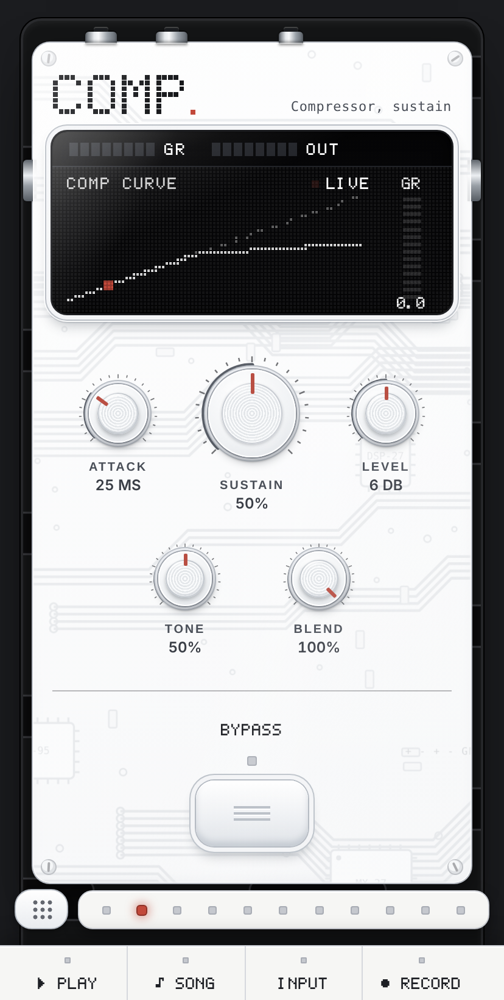
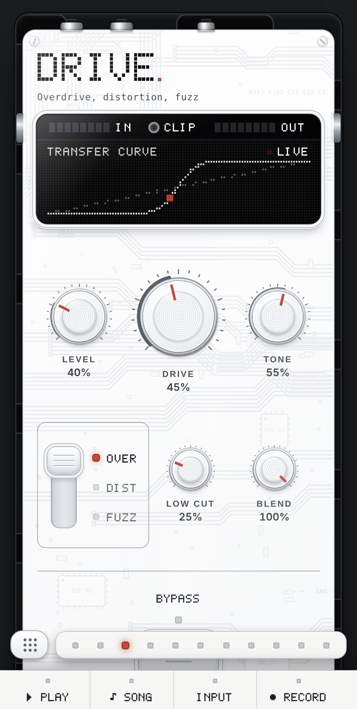
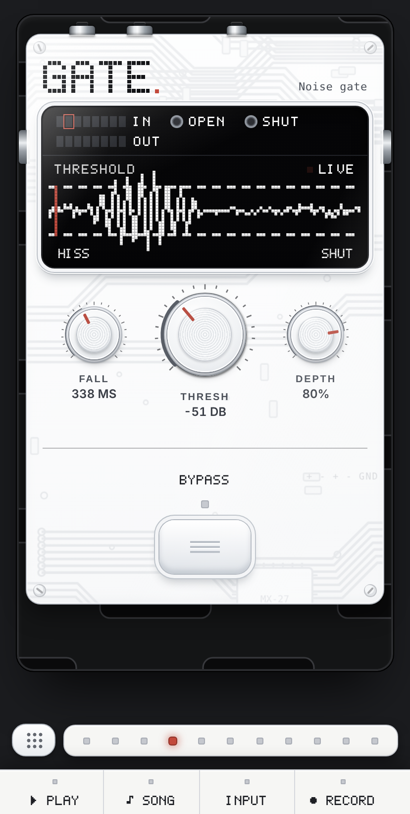
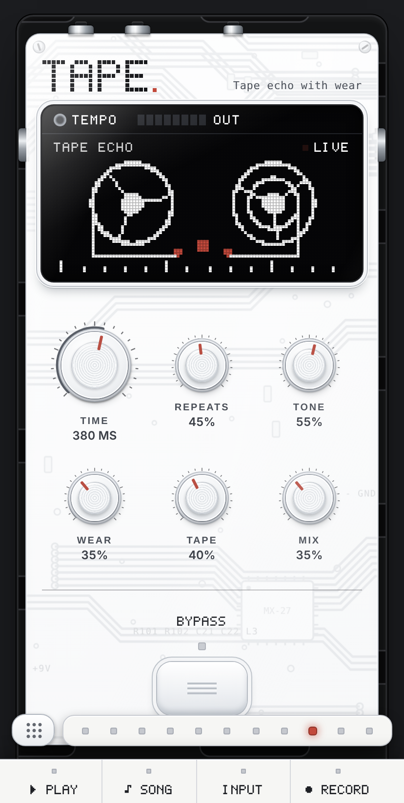
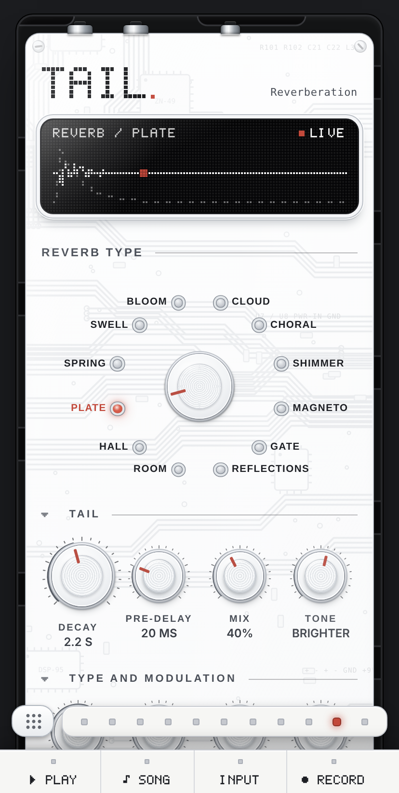
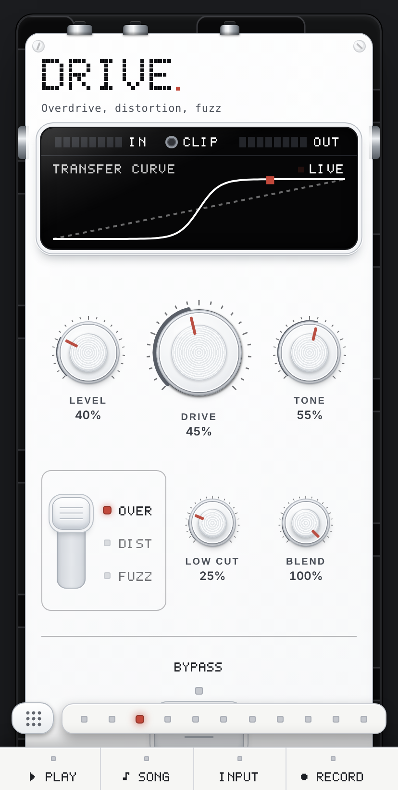
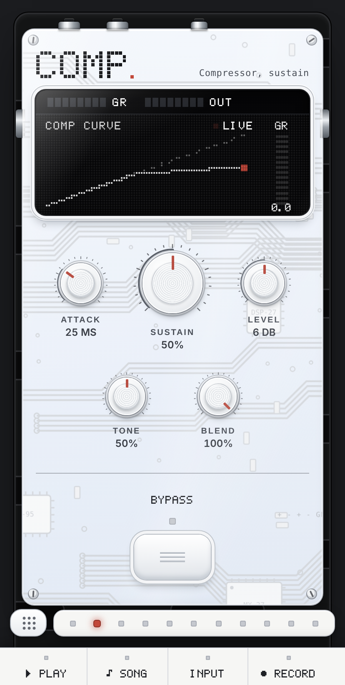
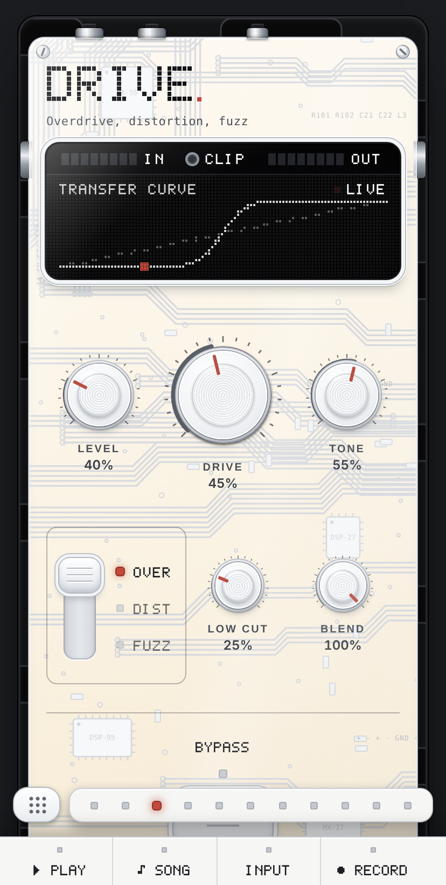

# LOOM

A board of eleven guitar effect pedals that runs in the browser (Web Audio, installable PWA, made for the phone).
One pedal on screen at a time, black dot-matrix OLED on every pedal, milky plastic body over a PCB, a single red accent.

**Live:** https://shoogaze.github.io/loom/

## Pedals

| | |
|---|---|
| **Source** | track file, guitar / piano demo loop, looper |
| **Comp** | compressor with a live curve screen |
| **Drive** | overdrive / distortion / fuzz |
| **Gate** | noise gate |
| **Wah** | filter / wah / auto-sweep |
| **Morph** | phaser, tremolo, ring modulator |
| **Swirl** | chorus, flanger, vibrato |
| **EQ** | six bands |
| **Tape** | tape echo with wear |
| **Tail** | reverb, ten types |
| **Scope** | output spectrum and tuner |

Swipe or use the pager to switch pedals; the keypad button opens the signal chain.

## Looks

Two switches live in the chain sheet:

- **Screens: full / simple** - full is the dot-matrix OLED with glare and the PCB under the plastic; simple is plain dark glass with smooth lines and no board (lighter on the phone).
- **Body: white / tint** - optional pastel tint per pedal.

## Screenshots

| Source | Comp | Drive |
|---|---|---|
|  |  |  |

| Gate | Wah | Morph |
|---|---|---|
|  |  |  |

| Swirl | EQ | Tape |
|---|---|---|
|  |  |  |

| Tail | Scope | Simple screens |
|---|---|---|
|  |  |  |

Body tint:

| Comp | Drive | Tape |
|---|---|---|
|  |  |  |

## Run

No build step. Serve the folder over HTTP (audio and the PWA need it), for example:

```
python3 -m http.server 8000
```

then open http://localhost:8000. On GitHub Pages just publish the repo root.
On iPhone: Share, then Add to Home Screen.

## Structure

```
index.html            markup
css/style.css         styles
js/app.js             audio engine and interface
font/fxpixel.ttf      5x7 pixel font used for titles and screens
icons/                app icons
manifest.webmanifest  PWA manifest
screens/              screenshots
```

## License

MIT, (c) Kirill Kinderhart
