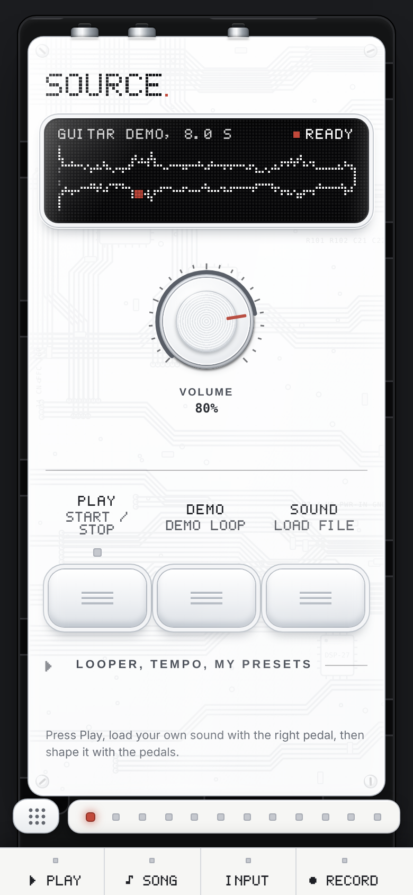
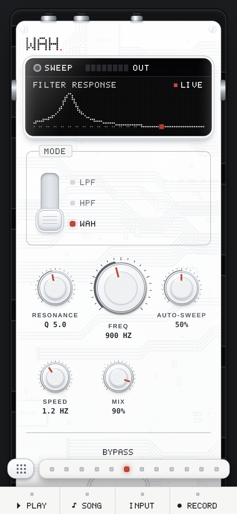
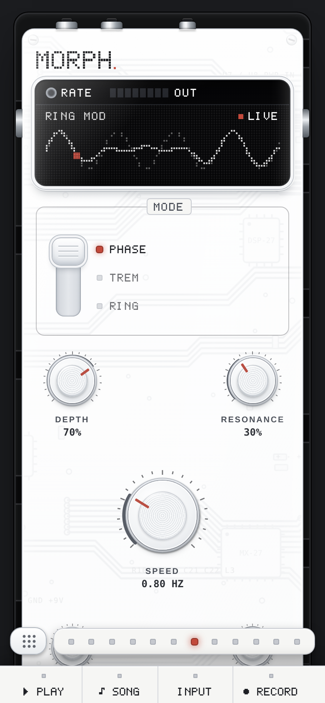
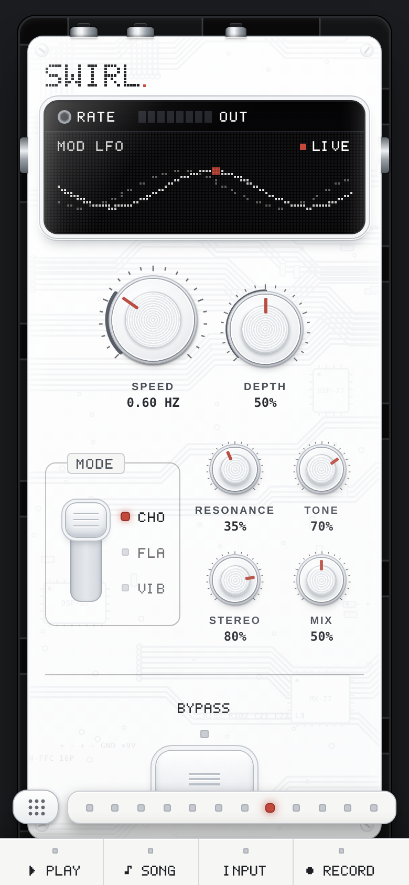
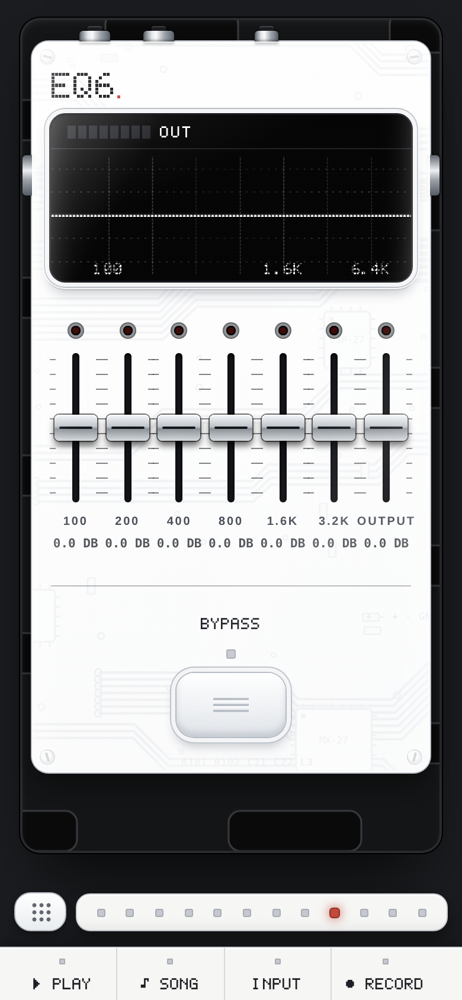
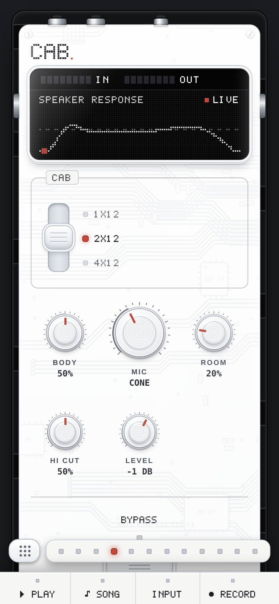
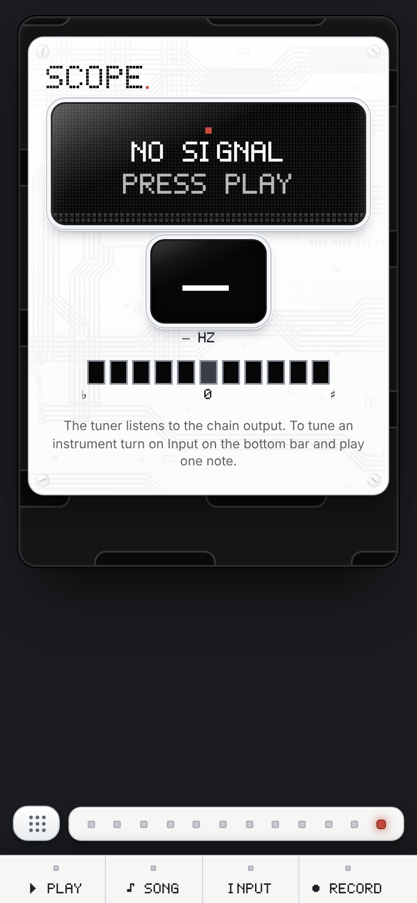
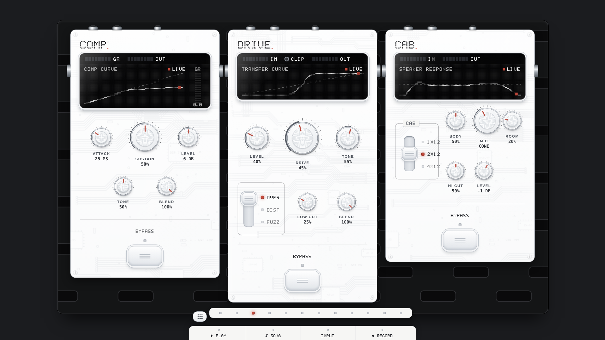
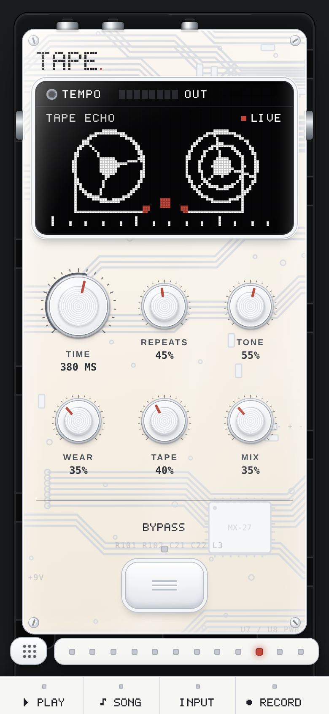

# LOOM

A board of twelve guitar effect pedals that runs in the browser (Web Audio, installable offline PWA, made for the phone).
One pedal on screen at a time, black dot-matrix OLED on every pedal, milky plastic body over a PCB, a single red accent.

**Live:** https://shoogaze.github.io/loom-pedalboard/

## Pedals

| | |
|---|---|
| **Source** | track file, guitar / piano demo loop, looper |
| **Comp** | compressor with a live curve screen |
| **Drive** | overdrive / distortion / fuzz |
| **Cab** | speaker cabinet: 1x12, 2x12, 4x12, mic position, room |
| **Gate** | noise gate |
| **Wah** | filter / wah / auto-sweep |
| **Morph** | phaser, tremolo, ring modulator |
| **Swirl** | chorus, flanger, vibrato |
| **EQ** | six bands |
| **Tape** | tape echo with wear |
| **Tail** | reverb, ten types |
| **Scope** | output spectrum and tuner |

On tablets and computers the pedal scales to fit the window (the phone layout is kept as is); on wide screens (1000 px and up) several pedals of the chain are shown side by side (switch in the chain sheet: Board multi / single); keys: Space = play/stop, left/right arrows or 1-0 = switch pedal, B = bypass the pedal on screen.

Swipe or use the pager to switch pedals; the keypad button opens the signal chain.

## Looks

Two switches live in the chain sheet:

- **Screens: full / simple** - full is the dot-matrix OLED with glare and the PCB under the plastic; simple is plain dark glass with smooth lines and no board (lighter on the phone).
- **Body: white / tint** - optional pastel tint per pedal.

## Screenshots

| Source | Comp | Drive |
|---|---|---|
|  |  |  |

| Gate | Wah | Morph |
|---|---|---|
|  |  |  |

| Swirl | EQ | Tape |
|---|---|---|
|  |  |  |

| Cab | Tail | Scope |
|---|---|---|
|  |  |  |

Simple screens and the wide-screen board:

| Simple | Board |
|---|---|
|  |  |

Body tint:

| Comp | Drive | Tape |
|---|---|---|
|  |  |  |

## Run

`index.html` is a ready build: serve the folder over HTTP (audio and the PWA need it), for example:

```
python3 -m http.server 8000
```

then open http://localhost:8000. On GitHub Pages just publish the repo root.
After the first visit the app works offline (service worker). On iPhone: Share, then Add to Home Screen.

## Develop

Edit the sources in `src/`, then rebuild the single file:

```
python3 build.py        # src/ + shared/ -> index.html
python3 tests/test_loom.py   # smoke tests (Playwright + Chrome)
```

Saved state is versioned (`v: 2`); on load the pedal order is migrated generically (unknown ids dropped, new pedals inserted at their default place).

## Structure

```
index.html              built single-file app (what gets published)
src/template.html       page markup
src/style.css           LOOM styles
src/app.js              audio engine and UI
src/sw-register.js      service worker registration
src/assets/             inlined data (pixel font, icons)
shared/ziiion-core.css  family look shared with ZIIION / IRIDESCENT (edge light, matte plastic, hierarchy)
build.py                assembles index.html
tests/                  smoke tests
sw.js, manifest.webmanifest, icons/   PWA
screens/                screenshots
```

## License

MIT, (c) Kirill Kinderhart
